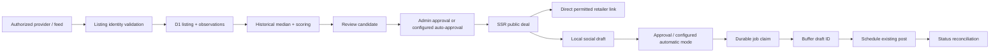

# Architecture

## Retailer current-offer integrations

Amazon US Creators API (OAuth 3.1, OffersV2) and Best Buy Products API use a separate display-only path: admin searches/watchlists → scheduled collector → `retailer_offer_cache` → SSR `/offers`. Both providers default disabled. Server readiness gates, exact IDs, HTTPS destinations, account-specific attribution, availability/condition checks, and per-provider cooldowns apply before publication. Searches fetch the first ten results; watchlists fetch up to ten explicit IDs.

Cache rows are replaced on refresh, expire within one hour (or an earlier Amazon promotion end), and are never copied to `products`, `product_listings`, `price_observations`, deals, or social drafts. Public reads require unexpired approved rows, enabled provider/target/category, current server authorization, and link revalidation. Cron deletes expired rows even with monitoring stopped. Error/audit records contain no raw retailer payloads or request URLs. The original historical monitoring and Buffer paths are unchanged. See RETAILER_SETUP.md for license limitations and activation.

## Runtime boundaries

The Astro Worker renders public and admin pages and handles validated server APIs. React hydrates the price chart only when visible. Recharts is lazy through an Astro island; server-rendered prices and observation tables remain readable without JavaScript. Tailwind 4 and the shared CSS design system implement responsive light/dark presentation.

The separate jobs Worker has a Scheduled handler and no public mutation endpoint. It runs monitoring and publishing from a Cloudflare Cron Trigger. Both Workers bind the same D1 database. This keeps Astro's documented unified entrypoint intact and avoids relying on an undocumented scheduled-handler merge. Astro sessions are disabled because administrator sessions use verified Access JWTs or a local signed cookie; no extra KV namespace is provisioned. Images are passed through; Cloudflare Images is not activated.

## Data flow

Products identify an exact brand/model/variant. Listings isolate provider ID, external ID, condition and currency. Observations additionally carry the identity key. Baseline and scoring filter by the same listing identity; used/new, different capacity/color and foreign currency observations never cross into a comparison. Monetary values use integer cents. No suggested original price is trusted.

The baseline is the median of previous known-shipping totals in a 30-day window, with at least eight distinct observed days, seven days of span, and bounded gaps including the gap to the current check. The score normalizes configurable weights and optional category adjustments, then enforces independent qualification gates. Changing a deal snapshot's total or losing availability expires it. Public queries independently hide stale/unavailable/disabled-category/demo-in-production offers.

## Durability and retries

D1 unique keys prevent duplicate provider listings, observations, deal fingerprints, local drafts, jobs and remote IDs. Monitoring run IDs correspond to half-hour slots; completed slots are skipped on retry. An expiring owner-specific distributed lock serializes each engine. Only due enabled listings enter bounded batches; temporary failures increase backoff, 429 pauses the provider, and authorization failure disables it until reviewed.

The publishing engine holds a separate lock, validates qualification again, checks the X channel, prevents recently posted substantially similar exact products, reserves times with minimum spacing and daily limits in America/New_York, and claims jobs before an outbound mutation. Buffer drafts are created with `saveToDraft: true`; their ID is stored before scheduling that existing post. Scheduling uses an explicit date so account queue slots cannot collapse the configured spacing.

There is no claim of universal exactly-once remote delivery: Buffer's documented create input does not provide a client idempotency key. A timeout, HTTP 5xx, malformed response or interrupted submitting lease may have created a remote resource. Such jobs are quarantined as `uncertain`, not retried automatically. A known remote ID can be reconciled via the documented post query. Unknown IDs require inspection in Buffer. Explicit rate-limit rejections are retried after a persisted cooldown. Authorization errors stop new publishing. Queue acceptance is distinct from successful social delivery.

Emergency stop blocks new work but cannot recall an in-flight request or undo already scheduled Buffer posts. Pause the channel externally too.

## Schema

The initial migration includes categories, retailers, providers, products, listings, observations, deals, scores, drafts, publishing jobs, click events, verified revenue, settings, job runs, errors, audit events, ephemeral rate-limit buckets and distributed locks. Foreign keys and query indexes support integrity and bounded queries. Observation history fetches the most recent 1,500 records per listing. For larger/higher-frequency catalogs, add daily rollups and evidence-aware retention before pruning observations.

Retention on monitoring runs removes 30-day errors/jobs, 90-day click analytics, 180-day audits and minute buckets older than ten minutes. Physical cleanup runs during successful monitoring, so pausing jobs also pauses this cleanup. Observations are retained; indexes and capacity monitoring matter as the catalog grows. Costs are documented in DEPLOYMENT.md.

## Extensibility

Provider refresh adapters have an ID and minimum request interval. The authorized importer is separate from unattended refresh: it records real arrivals, not pretend price checks. Affiliate adapters select permitted retailer destinations without misleading redirects. Buffer transport can be replaced with mocked fetches in tests. Source adapters, scoring, repositories and presentation remain separate modules.

The active Cron publishing engine polls up to three queued posts per run, records actual sent/error status, and moves unsent invalid or expired offers back to Buffer drafts. This requires publishing to remain enabled and authorized. Price/stock can still change between checks or while a post is already sending; disable/pause the channel when intervening immediately.
